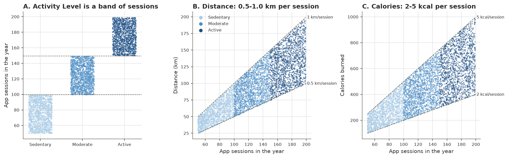
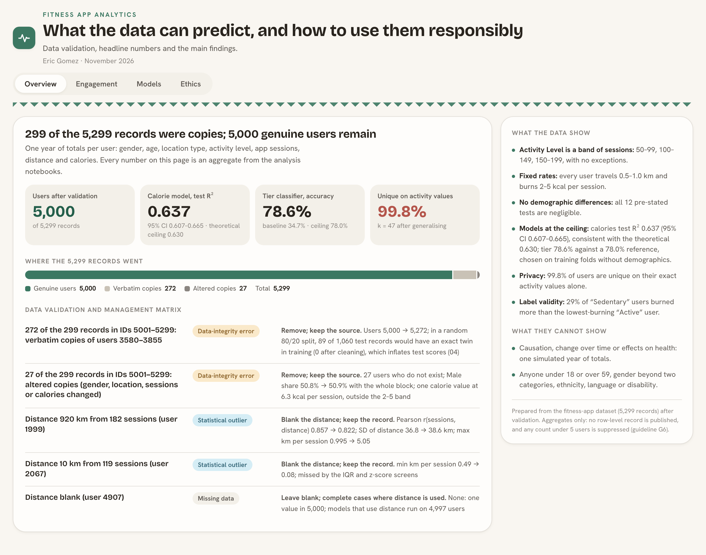

# Fitness app users: engagement, prediction and responsible data use

Eric Gomez · November 2026

This project analyses one year of user records from a fitness-tracking app. Each record holds a user's gender,
age, location type, activity level, app sessions, distance travelled and calories burned. The analysis asks
four things:
- which patterns of engagement the records actually support;
- how well user behaviour and app use can be predicted, measured out of sample against baselines and ceilings;
- what the results mean for the software team building a personalised workout-recommendation feature;
- what the data mean for privacy, fairness and cultural relevance, and which guidelines follow.

## Approach

| Notebook | What it does |
|---|---|
| [`01_data_understanding`](notebooks/Ass2-Fitness_01_data_understanding.ipynb) | Profiles the raw file and validates it record by record. Each problem gets one of four classifications (critical anomaly, data-integrity error, statistical outlier, missing data) and a decision backed by evidence. |
| [`02_eda`](notebooks/Ass2-Fitness_02_eda.ipynb) | Applies the cleaning and computes what keeping each problem would have changed (the validation and management matrix). Describes the structure of engagement and the demographic profile. |
| [`03_analysis`](notebooks/Ass2-Fitness_03_analysis.ipynb) | Tests twelve pre-stated hypotheses on demographic differences, with effect sizes, the Holm correction, equivalence (TOST) verdicts and a power analysis. |
| [`04_modeling`](notebooks/Ass2-Fitness_04_modeling.ipynb) | Builds a calorie regression, a tier classifier and a k-means segmentation. Each is compared with a baseline and a structural ceiling. Every choice is made on cross-validation folds by a rule stated in advance, and the held-out test set is scored only afterwards. Also covers overfitting and calibration checks, prediction intervals, two leakage checks, a sensitivity analysis and an input contract. |
| [`05_ethics`](notebooks/Ass2-Fitness_05_ethics.ipynb) | Measures re-identification risk (k-anonymity, l-diversity), the cost of differential privacy, subgroup performance with a replication check, and whether the activity label measures activity. Sets out twelve ethical guidelines and builds the dashboard. |

The reusable code (loading, quality checks, statistical tests, model evaluation, clustering diagnostics, privacy
and fairness checks, the dashboard) lives in `src/`, with standalone tests in `tests/`. The project structure
follows the [MSE803 Analytics Template](../../MSE803-Analytics-Template/).

## Key results

- **Data quality.** 299 of the 5,299 records (5.6%) were copies of users 3580–3855: 272 exact and 27 altered.
  Two distances were ×10 entry errors (920 km and 10 km). A per-session rule caught both; the IQR and z-score
  screens missed the 10 km value. 5,000 genuine users remain.
- **A rigid structure.** *Activity Level* is a banding of app sessions (50–99, 100–149, 150–199), with no
  exceptions. Every user travels 0.5–1.0 km and burns 2–5 kcal per session, spread evenly and independently.
  The data behave like a simulation.
- **Negligible demographic differences in this dataset.** All twelve pre-stated tests are negligible: every 90% interval lies inside the
  conventional small-effect bounds, and the tests had the power to detect effects at those bounds.
- **Models at their ceilings.**
  - Calories: linear regression on sessions scores R² 0.637 on 1,000 held-out users (95% CI 0.607–0.665; MAE 92 kcal),
    consistent with the theoretical ceiling of 0.630. Random forest and gradient boosting do no better.
  - Tier from distance and calories: logistic regression, chosen on the training folds by a rule stated in
    advance (one-standard-error rule, simplest tied model), scores 78.6% on the test set (95% CI 76.0–81.1; macro
    F1 0.786, ROC-AUC 0.927). The baseline is 34.7% and the structural Bayes ceiling 78.0% (point estimate;
    McNemar p = .47). Adding age, gender and location changes nothing (78.2%), and the probabilities are well
    calibrated (calibration slopes 0.98–1.11).
  - Overfitting: gradient boosting and the random forest score 11.8 and 6.4 points higher on their training
    folds than on validation folds; logistic regression 0.2.
  - Segmentation: no natural segments (Hopkins 0.49, silhouette ≤ 0.28 at every k).
- **Two traps.** Predicting the tier from sessions scores 100% (leakage). Keeping the copies would flatter
  memorising models by up to 2.5 points and would rank the random forest above logistic regression.
- **An input contract.** A distance and a calorie count are accepted only if some session count could have
  produced both. The contract rejects both ×10 errors without needing sessions.
- **Privacy.** 99.8% of users are unique on their exact sessions, distance and calories alone. Generalising age
  and replacing sessions with the tier gives groups of at least 47.
- **Label validity.** 29% of "Sedentary" users burned more calories than the lowest-burning "Active" user. The
  label measures app use, not activity.



## Dashboard

[`outputs/dashboards/fitness_dashboard.html`](outputs/dashboards/fitness_dashboard.html) presents the results in four
views: overview, engagement, models and ethics. It is a single self-contained file that loads no outside script,
so it can be downloaded and opened offline.

It follows the project's own privacy guideline (G6). It carries only aggregate results tables and one binned
count of users, with any cell under five users suppressed.



## Data

The raw file was provided for coursework and is not included in this repository (`dataset for assignment 2-0426.csv`,
5,299 rows, one per user). The cleaned row-level table (`data/processed/users.csv`) also stays local. Even
though the data appear simulated, publishing exact per-user values would contradict guideline G6. Every figure and
results table is in `outputs/`.

## Running it

To re-run the analysis from scratch, place the raw file in `data/raw/`, then run the following from this folder:

```bash
pip install -r requirements.txt
jupyter nbconvert --to notebook --execute --inplace notebooks/*.ipynb
python tests/test_evaluation.py      # also test_clustering.py, test_ethics.py, test_quality.py, test_dashboard.py
python -m src.visualization.dashboard --screenshot      # optional: PNGs of the four views; needs Google Chrome
```

The notebooks run in order (`01` → `05`); `04` writes held-out predictions to `data/interim/` for `05`. The random
seed is 803 throughout.

## Context

This analysis was prepared for MSE803 Data Analytics, Assessment 2. The table shows where the evidence for each
criterion sits.

| Criterion | Evidence |
|---|---|
| Task 1 · Data analysis | `01`: validation and decisions; `02`: validation matrix, structure, demographic profile; `03`: hypothesis tests |
| Task 1 · Model performance evaluation | `04`: baselines, cross-validation, held-out metrics with intervals, ceilings, McNemar, prediction intervals, leakage and sensitivity checks, software-engineering implications |
| Task 2 · Ethical implications | `05`: re-identification risk, generalisation, differential privacy |
| Task 2 · Cultural relevance | `05`: representation audit, subgroup audit with replication, label validity, cultural factors |
| Task 2 · Ethical guidelines | `05`: twelve guidelines by development stage, each with a check |
